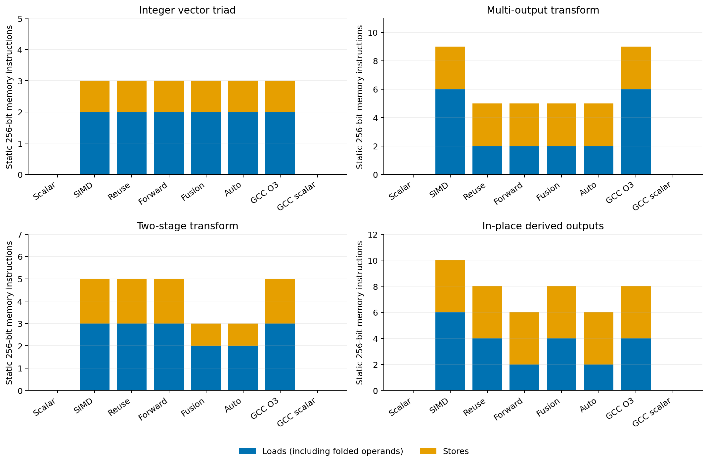
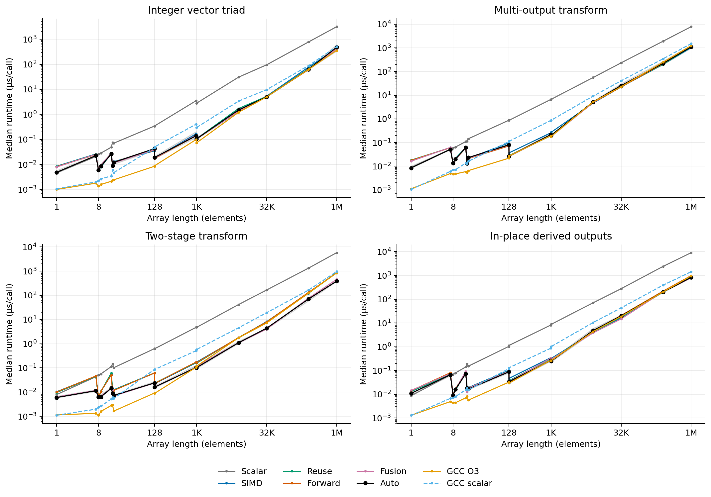
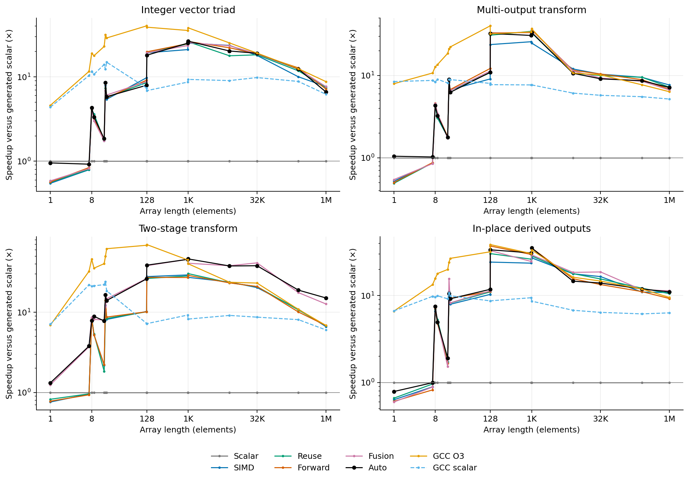
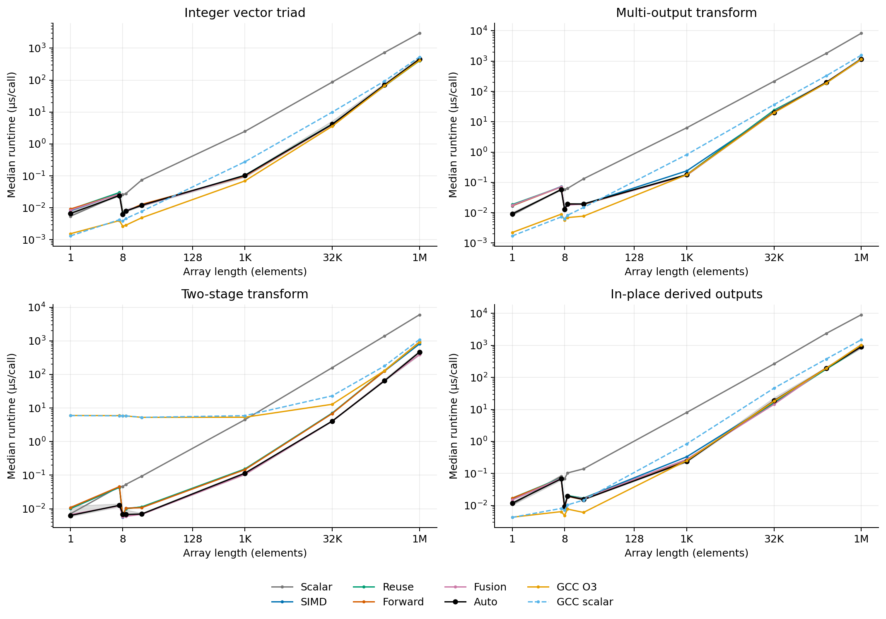
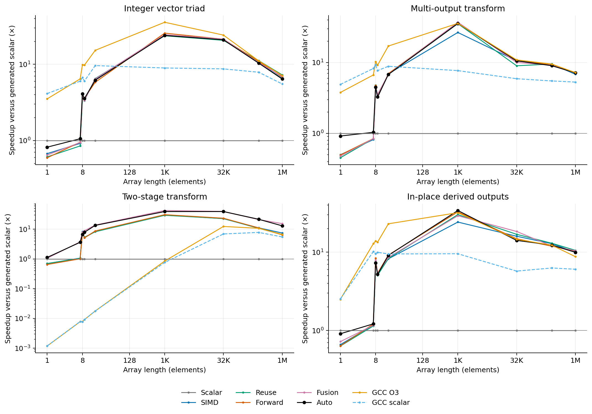
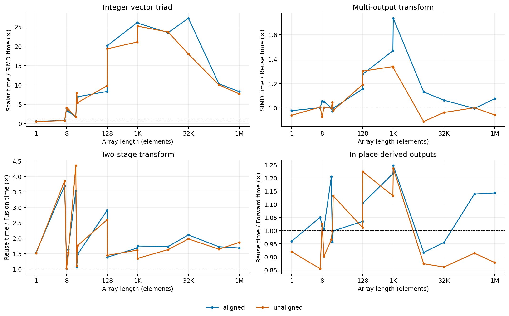

# Application-oriented experimental evaluation

Recorded: **2026-11-01 21:15:28 IST**. GCC: gcc (Ubuntu 13.3.0-6ubuntu2~24.04.1) 13.3.0. Raw timestamps are UTC. Results below are generated from retained measurements.

## Objectives and benchmark suitability

Four simplified pointwise integer kernels evaluate the existing compiler through TinyC → typed TAC → loop/memory analysis → legal candidates → cost selection → assembly → linked native code. These are computational kernels, not complete applications. The vector triad is an integer adaptation of the familiar triad pattern, not the official STREAM benchmark.

| Kernel | Computation and optimization exercised |
|---|---|
| Integer vector triad | `C=A+3B`; contiguous AVX2 addition/multiplication, scalar tails and profitability |
| Multi-output | `C=A+B; D=A-B; E=A*B`; repeated input loads and read reuse |
| Two-stage | Local `T=A+B`, followed by `C=3T`; restricted fusion and temporary traffic elimination |
| In-place derived outputs | `A=A+B; C=3A; D=A-B; A=D+2`; stored-A and stored-D forwarding with four ordered stores |

All four source programs were accepted without direct-TAC input or compiler changes. The subset requires int32 arithmetic, declarations before `for`, canonical unit-step loops, exact `base[i]` accesses and at most six register arguments. The multi-output signature uses all six (five pointers and n). Unsupported general C constructs were not assumed available.
The two-stage temporary is a non-escaping local fixed array, with no later observable use. Runtime-bound code reserves 1,048,576 int32 elements (~4 MiB stack); static variants use `max(1,N)`. At N=0 there are zero iterations, not a zero-length C array. Caller allocations must be valid. The in-place benchmark reads after its first A store and its D store; it does not read after the final A store, so it does not independently test forwarding from that final write.

## Experimental setup and methodology

- CPU: Intel Core i7-1255U, AVX2, WSL Ubuntu; affinity restricted to guest logical CPU **[0]**. Guest core type: `not exposed`. WSL affinity does not establish physical P-core/E-core placement, fixed frequency or exclusive host scheduling.
- 28,288 raw samples; 1,664 implementation/configuration medians; 17 timed samples per configuration. Five warmup calls. Modes: scalar, simd, reuse, forward, fusion, auto, GCC O3 and GCC O3 with both loop and SLP vectorization disabled.
- GCC uses `-O3 -march=native -fwrapv -fPIC`; the non-vectorized reference adds `-fno-tree-vectorize -fno-tree-slp-vectorize`. The identical specialized C computation is used, without `restrict` or manual SIMD. GCC optimization diagnostics and linked disassembly are retained.
- Static lengths: `[0, 1, 7, 8, 9, 15, 16, 17, 127, 128, 1003, 1024, 8192, 32768, 262144, 1048576]`. Dynamic lengths: `[0, 1, 7, 8, 9, 17, 1024, 32768, 262144, 1048576]`. Each dynamic kernel uses one shared binary for all lengths; static specialization changes only the literal bound and local temporary extent, equally for TinyC and GCC.
- Timed layouts are disjoint, with 64-byte-aligned or four-byte-offset bases. Aliasing is validated separately. All compiler runtime guards remain in the measured code.
- Timing uses `steady_clock`; initialization, driver heap allocation, compilation, resets, oracle execution, verification and I/O are outside the interval. Repetition counts are identical across all implementations: `max(8,min(500000,8000000/max(1,N)))`. Function calls, kernel stack-frame setup/probes and return accumulation are included.
- A fixed-seed random permutation is cyclically rotated to balance mode positions in each eight-round block. All five allocations are restored before every sample, including the in-place input. Every timed batch is checked against GCC executing the same number of calls from identical data. External calls plus a consumed return checksum prevent elimination; full output verification happens outside timing.
- Inputs use `std::mt19937` seeds 19, 627 and 2026 for correctness and 2026 for timing, with `int(rng()%201)-100`; allocation elements 0..2 are forced to -100, 0, 100. Wrapping int32 operations match the backend contract and GCC `-fwrapv` even under overlapping or repeated updates.
- Medians, quartiles, minima and maxima are retained. Effect intervals use 2,000 fixed-seed paired bootstrap resamples of sample-round speedup ratios; they are exploratory, without multiple-comparison correction. No model coefficients were fitted or changed.

## Correctness and regressions

Application verification completed **before accepted timing**: **19,968 kernel executions**, **16,896 complete-allocation/return comparisons**, including **768 instrumented path checks**. The matrix uses all 16 lengths, three seeds, six alias layouts and eight implementations for both static and dynamic source families.
The alias layouts are disjoint, C=A, B=A, C=A+1, C=A−1, and D=C with E=C+1. Separate instrumented auto binaries count vector batches with capability enabled and forced disabled. They verify the threshold, alias fallback, vector execution and tails; timed binaries contain no counters. CPU-disabled tests do not constitute testing on physical non-AVX2 hardware.
The original suite remains separate and unchanged: `make test-memory` passed 41,400 executions and 34,560 comparisons; `make test-runtime` passed 152 checks. `make build`, the original frontend/backend/vectorization tests, `test-p3-suite` and `test-btp-scalar` also passed. Logs are under `build/application-audit/`. No compiler correctness fix was needed.

## Linked machine-code evidence

The table uses N=1024. Counts are static 256-bit instructions, summing one iteration of each main vector loop. The inspected loops each advance eight int32 elements (GCC increments addresses by 32 bytes). Two separate passes therefore contribute two loop bodies to the sum. Folded memory operands in GCC arithmetic count as loads. Scalar fallback, guards, broadcasts and SSE epilogues are excluded from these loop counts. These counts do not measure dynamic instructions, cache misses or DRAM bytes.

| Kernel | Mode | Loads | Stores | Vector arithmetic | Selected plan |
|---|---|---:|---:|---:|---|
| Integer vector triad | scalar | 0 | 0 | 0 | scalar |
| Integer vector triad | simd | 2 | 1 | 2 | simd |
| Integer vector triad | reuse | 2 | 1 | 2 | reuse |
| Integer vector triad | forward | 2 | 1 | 2 | forward |
| Integer vector triad | fusion | 2 | 1 | 2 | reuse |
| Integer vector triad | auto | 2 | 1 | 2 | simd |
| Integer vector triad | gcc | 2 | 1 | 3 | gcc |
| Integer vector triad | gcc_scalar | 0 | 0 | 0 | gcc_scalar |
| Multi-output transform | scalar | 0 | 0 | 0 | scalar |
| Multi-output transform | simd | 6 | 3 | 3 | simd |
| Multi-output transform | reuse | 2 | 3 | 3 | reuse |
| Multi-output transform | forward | 2 | 3 | 3 | forward |
| Multi-output transform | fusion | 2 | 3 | 3 | reuse |
| Multi-output transform | auto | 2 | 3 | 3 | reuse |
| Multi-output transform | gcc | 6 | 3 | 3 | gcc |
| Multi-output transform | gcc_scalar | 0 | 0 | 0 | gcc_scalar |
| Two-stage transform | scalar | 0 | 0 | 0 | scalar+scalar |
| Two-stage transform | simd | 3 | 2 | 2 | simd+simd |
| Two-stage transform | reuse | 3 | 2 | 2 | reuse+reuse |
| Two-stage transform | forward | 3 | 2 | 2 | forward+forward |
| Two-stage transform | fusion | 2 | 1 | 2 | fusion |
| Two-stage transform | auto | 2 | 1 | 2 | fusion |
| Two-stage transform | gcc | 3 | 2 | 3 | gcc |
| Two-stage transform | gcc_scalar | 0 | 0 | 0 | gcc_scalar |
| In-place derived outputs | scalar | 0 | 0 | 0 | scalar |
| In-place derived outputs | simd | 6 | 4 | 4 | simd |
| In-place derived outputs | reuse | 4 | 4 | 4 | reuse |
| In-place derived outputs | forward | 2 | 4 | 4 | forward |
| In-place derived outputs | fusion | 4 | 4 | 4 | reuse |
| In-place derived outputs | auto | 2 | 4 | 4 | forward |
| In-place derived outputs | gcc | 4 | 4 | 5 | gcc |
| In-place derived outputs | gcc_scalar | 0 | 0 | 0 | gcc_scalar |

GCC 13.3 vectorizes the four representative N=1024 kernels with 32-byte vectors. Its two-stage code retains two separate vector loops and temporary memory accesses; fusion is not observed there. GCC uses shift/add for multiplication by three. The multi-output GCC loop contains three explicit vector loads plus three folded memory operands (six reads), not three total reads. The non-vectorized GCC variants have no YMM instructions. Small fixed loops may instead be unrolled straight-line code or use SSE; `count_scope`, XMM/YMM presence, region boundaries and GCC diagnostics are recorded rather than treating those as eight-element AVX2 loops.



## Runtime results

The following tables show preselected small, medium and large lengths, using static bounds and unaligned arrays. Runtime and IQR are in microseconds per call. Speedup is generated-scalar median / implementation median. Full data include all lengths, both alignments and both bound policies. An asterisk marks GCC whole-function straight-line 256-bit counts, which are not per-loop iteration counts. Zero vector counts do not imply no computation.
Read reuse is compared with basic SIMD, forwarding with reuse, and fusion with the unfused reuse mode. Speedups against the TAC scalar backend include removing its stack spills and address temporaries, so they are not a pure SIMD-width effect. GCC provides an additional independently optimized baseline.

### Integer vector triad

| N | Implementation | Median µs | IQR µs | Speedup vs scalar | Vector loads/stores | Correctness |
|---:|---|---:|---:|---:|---|---|
| 8 | scalar | 0.0258 | [0.0247, 0.0267] | 1.000x | 0/0 | PASS |
| 8 | simd | 0.0063 | [0.0060, 0.0069] | 4.088x | 2/1 | PASS |
| 8 | reuse | 0.0062 | [0.0059, 0.0065] | 4.143x | 2/1 | PASS |
| 8 | forward | 0.0063 | [0.0057, 0.0074] | 4.124x | 2/1 | PASS |
| 8 | fusion | 0.0062 | [0.0058, 0.0070] | 4.154x | 2/1 | PASS |
| 8 | auto | 0.0060 | [0.0057, 0.0074] | 4.326x | 2/1 | PASS |
| 8 | gcc | 0.0014 | [0.0013, 0.0016] | 19.013x | 2/1* | PASS |
| 8 | gcc_scalar | 0.0022 | [0.0021, 0.0027] | 11.591x | 0/0 | PASS |
| 1024 | scalar | 2.7951 | [2.6125, 2.8420] | 1.000x | 0/0 | PASS |
| 1024 | simd | 0.1110 | [0.1011, 0.1213] | 25.176x | 2/1 | PASS |
| 1024 | reuse | 0.1069 | [0.1054, 0.1166] | 26.136x | 2/1 | PASS |
| 1024 | forward | 0.1061 | [0.0973, 0.1157] | 26.332x | 2/1 | PASS |
| 1024 | fusion | 0.1096 | [0.0976, 0.1486] | 25.501x | 2/1 | PASS |
| 1024 | auto | 0.1053 | [0.0997, 0.1149] | 26.549x | 2/1 | PASS |
| 1024 | gcc | 0.0731 | [0.0705, 0.0821] | 38.222x | 2/1 | PASS |
| 1024 | gcc_scalar | 0.2991 | [0.2823, 0.3404] | 9.346x | 0/0 | PASS |
| 262144 | scalar | 781.6846 | [759.8168, 866.8413] | 1.000x | 0/0 | PASS |
| 262144 | simd | 77.9293 | [61.7263, 83.1487] | 10.031x | 2/1 | PASS |
| 262144 | reuse | 66.2051 | [60.7894, 76.6163] | 11.807x | 2/1 | PASS |
| 262144 | forward | 61.1331 | [60.3334, 68.5463] | 12.787x | 2/1 | PASS |
| 262144 | fusion | 63.3589 | [59.8731, 68.3571] | 12.337x | 2/1 | PASS |
| 262144 | auto | 63.0106 | [61.7631, 70.9188] | 12.406x | 2/1 | PASS |
| 262144 | gcc | 62.4654 | [57.2320, 71.0830] | 12.514x | 2/1 | PASS |
| 262144 | gcc_scalar | 88.4368 | [80.9349, 96.2218] | 8.839x | 0/0 | PASS |

### Multi-output transform

| N | Implementation | Median µs | IQR µs | Speedup vs scalar | Vector loads/stores | Correctness |
|---:|---|---:|---:|---:|---|---|
| 8 | scalar | 0.0583 | [0.0575, 0.0621] | 1.000x | 0/0 | PASS |
| 8 | simd | 0.0129 | [0.0121, 0.0149] | 4.538x | 6/3 | PASS |
| 8 | reuse | 0.0139 | [0.0123, 0.0163] | 4.205x | 2/3 | PASS |
| 8 | forward | 0.0127 | [0.0119, 0.0139] | 4.595x | 2/3 | PASS |
| 8 | fusion | 0.0128 | [0.0121, 0.0139] | 4.549x | 2/3 | PASS |
| 8 | auto | 0.0135 | [0.0124, 0.0148] | 4.309x | 2/3 | PASS |
| 8 | gcc | 0.0046 | [0.0041, 0.0054] | 12.737x | 6/3* | PASS |
| 8 | gcc_scalar | 0.0070 | [0.0064, 0.0081] | 8.372x | 0/0 | PASS |
| 1024 | scalar | 6.6819 | [6.4114, 7.0778] | 1.000x | 0/0 | PASS |
| 1024 | simd | 0.2694 | [0.2545, 0.2922] | 24.799x | 6/3 | PASS |
| 1024 | reuse | 0.2026 | [0.1767, 0.2193] | 32.982x | 2/3 | PASS |
| 1024 | forward | 0.1871 | [0.1736, 0.2184] | 35.708x | 2/3 | PASS |
| 1024 | fusion | 0.1837 | [0.1719, 0.2270] | 36.366x | 2/3 | PASS |
| 1024 | auto | 0.2003 | [0.1748, 0.2118] | 33.356x | 2/3 | PASS |
| 1024 | gcc | 0.1805 | [0.1763, 0.1984] | 37.012x | 6/3 | PASS |
| 1024 | gcc_scalar | 0.8687 | [0.8505, 0.9919] | 7.691x | 0/0 | PASS |
| 262144 | scalar | 1914.0725 | [1830.3712, 1955.8115] | 1.000x | 0/0 | PASS |
| 262144 | simd | 201.2791 | [188.6587, 254.1699] | 9.510x | 6/3 | PASS |
| 262144 | reuse | 201.0627 | [191.6664, 255.8248] | 9.520x | 2/3 | PASS |
| 262144 | forward | 214.8119 | [191.1703, 268.0947] | 8.910x | 2/3 | PASS |
| 262144 | fusion | 224.9236 | [187.7830, 255.7517] | 8.510x | 2/3 | PASS |
| 262144 | auto | 221.2971 | [192.5900, 275.3019] | 8.649x | 2/3 | PASS |
| 262144 | gcc | 248.1730 | [220.3136, 279.0616] | 7.713x | 6/3 | PASS |
| 262144 | gcc_scalar | 346.2724 | [328.3654, 376.6860] | 5.528x | 0/0 | PASS |

### Two-stage transform

| N | Implementation | Median µs | IQR µs | Speedup vs scalar | Vector loads/stores | Correctness |
|---:|---|---:|---:|---:|---|---|
| 8 | scalar | 0.0498 | [0.0453, 0.0512] | 1.000x | 0/0 | PASS |
| 8 | simd | 0.0058 | [0.0054, 0.0066] | 8.534x | 3/2 | PASS |
| 8 | reuse | 0.0058 | [0.0054, 0.0065] | 8.524x | 3/2 | PASS |
| 8 | forward | 0.0060 | [0.0055, 0.0066] | 8.337x | 3/2 | PASS |
| 8 | fusion | 0.0058 | [0.0057, 0.0060] | 8.632x | 2/1 | PASS |
| 8 | auto | 0.0064 | [0.0056, 0.0072] | 7.843x | 2/1 | PASS |
| 8 | gcc | 0.0011 | [0.0010, 0.0012] | 45.943x | 2/1* | PASS |
| 8 | gcc_scalar | 0.0024 | [0.0023, 0.0026] | 21.133x | 0/0 | PASS |
| 1024 | scalar | 4.7278 | [4.6325, 5.0054] | 1.000x | 0/0 | PASS |
| 1024 | simd | 0.1734 | [0.1532, 0.1903] | 27.261x | 3/2 | PASS |
| 1024 | reuse | 0.1558 | [0.1525, 0.1621] | 30.336x | 3/2 | PASS |
| 1024 | forward | 0.1638 | [0.1528, 0.2165] | 28.859x | 3/2 | PASS |
| 1024 | fusion | 0.1157 | [0.1042, 0.1621] | 40.864x | 2/1 | PASS |
| 1024 | auto | 0.1022 | [0.0931, 0.1239] | 46.241x | 2/1 | PASS |
| 1024 | gcc | 0.1175 | [0.1066, 0.1523] | 40.242x | 3/2 | PASS |
| 1024 | gcc_scalar | 0.5753 | [0.5137, 0.6253] | 8.217x | 0/0 | PASS |
| 262144 | scalar | 1332.9303 | [1262.4627, 1381.1378] | 1.000x | 0/0 | PASS |
| 262144 | simd | 121.9876 | [116.9956, 155.7440] | 10.927x | 3/2 | PASS |
| 262144 | reuse | 124.8274 | [110.5763, 145.6868] | 10.678x | 3/2 | PASS |
| 262144 | forward | 132.2874 | [115.3392, 148.7232] | 10.076x | 3/2 | PASS |
| 262144 | fusion | 75.8169 | [67.4219, 91.3608] | 17.581x | 2/1 | PASS |
| 262144 | auto | 70.5959 | [59.2716, 80.6066] | 18.881x | 2/1 | PASS |
| 262144 | gcc | 122.7897 | [108.7278, 144.1741] | 10.855x | 3/2 | PASS |
| 262144 | gcc_scalar | 164.8127 | [152.7594, 174.0180] | 8.088x | 0/0 | PASS |

### In-place derived outputs

| N | Implementation | Median µs | IQR µs | Speedup vs scalar | Vector loads/stores | Correctness |
|---:|---|---:|---:|---:|---|---|
| 8 | scalar | 0.0688 | [0.0660, 0.0750] | 1.000x | 0/0 | PASS |
| 8 | simd | 0.0104 | [0.0091, 0.0121] | 6.603x | 6/4 | PASS |
| 8 | reuse | 0.0099 | [0.0090, 0.0111] | 6.933x | 4/4 | PASS |
| 8 | forward | 0.0097 | [0.0088, 0.0113] | 7.116x | 2/4 | PASS |
| 8 | fusion | 0.0091 | [0.0087, 0.0093] | 7.570x | 4/4 | PASS |
| 8 | auto | 0.0091 | [0.0085, 0.0101] | 7.527x | 2/4 | PASS |
| 8 | gcc | 0.0044 | [0.0042, 0.0045] | 15.740x | 4/4* | PASS |
| 8 | gcc_scalar | 0.0071 | [0.0069, 0.0076] | 9.634x | 0/0 | PASS |
| 1024 | scalar | 8.6954 | [8.5013, 10.6272] | 1.000x | 0/0 | PASS |
| 1024 | simd | 0.3197 | [0.3095, 0.4736] | 27.197x | 6/4 | PASS |
| 1024 | reuse | 0.3043 | [0.2721, 0.3772] | 28.578x | 4/4 | PASS |
| 1024 | forward | 0.2460 | [0.2345, 0.2646] | 35.354x | 2/4 | PASS |
| 1024 | fusion | 0.2955 | [0.2537, 0.3938] | 29.429x | 4/4 | PASS |
| 1024 | auto | 0.2460 | [0.2274, 0.2801] | 35.345x | 2/4 | PASS |
| 1024 | gcc | 0.2597 | [0.2398, 0.3055] | 33.477x | 4/4 | PASS |
| 1024 | gcc_scalar | 1.0076 | [0.8489, 1.2263] | 8.630x | 0/0 | PASS |
| 262144 | scalar | 2399.4504 | [2322.1994, 2538.6683] | 1.000x | 0/0 | PASS |
| 262144 | simd | 218.3978 | [186.8410, 244.7856] | 10.987x | 6/4 | PASS |
| 262144 | reuse | 197.2633 | [183.3336, 227.4465] | 12.164x | 4/4 | PASS |
| 262144 | forward | 215.7504 | [190.4536, 224.8506] | 11.121x | 2/4 | PASS |
| 262144 | fusion | 205.9160 | [191.3816, 265.0107] | 11.653x | 4/4 | PASS |
| 262144 | auto | 200.9905 | [191.7004, 232.7063] | 11.938x | 2/4 | PASS |
| 262144 | gcc | 201.4112 | [186.0117, 243.1412] | 11.913x | 4/4 | PASS |
| 262144 | gcc_scalar | 389.5520 | [364.6831, 404.4054] | 6.160x | 0/0 | PASS |



Static, unaligned medians; log axes. The shaded auto band is its interquartile range. N=0 is retained in CSV/tables but omitted from the logarithmic size plots.





Runtime-bound, unaligned medians, including GCC stack-frame/probe costs. The two-stage GCC curve for small N includes the fixed 4 MiB probe loop; this is analyzed separately below.





Effect plots use the appropriate baseline for each transformation. Ratios below one are slowdowns. Named modes may be identical code; any timing difference between identical implementations is not attributed to the named optimization.

## Cost-model assessment

The original analytical weights remain unchanged. Candidate costs are in analytical cycle-like units, not measured nanoseconds. Static cases use exact bounds; dynamic candidates retain the documented assumed trip count 1024. Non-fused auto plans additionally dispatch using the actual trip count; fused plans retain their existing policy without a runtime threshold.
Exact linked function-byte hashes group equivalent explicit implementations before choosing the fastest pooled-median group. Auto samples are not pooled into those groups. Dynamic dispatch is distinguished from byte identity: the selected branch is matched to the corresponding explicit implementation, while its actual timing still includes dispatch overhead. Correctness/alias checks are identical to those tested above.

| Domain | Prediction agreement | Auto within 5% of fastest group | Median runtime ratio auto/best | Maximum ratio |
|---|---:|---:|---:|---:|
| static | 103/128 | 91/128 | 1.006 | 1.290 |
| dynamic | 65/80 | 54/80 | 1.016 | 2.230 |

Legal-candidate estimates for representative static inputs (separate-loop costs summed; a fused cost shown only when that candidate is legal):

| Kernel | N | Scalar | SIMD | Reuse | Forward | Fused | Auto plan |
|---|---:|---:|---:|---:|---:|---:|---|
| Integer vector triad | 1 | 30.0 | 51.0 | 51.0 | 51.0 | — | scalar |
| Integer vector triad | 8 | 240.0 | 29.0 | 29.0 | 29.0 | — | simd |
| Integer vector triad | 1024 | 30720.0 | 1045.0 | 1045.0 | 1045.0 | — | simd |
| Integer vector triad | 262144 | 7962624.0 | 360469.0 | 360469.0 | 360469.0 | — | simd |
| Multi-output transform | 1 | 72.0 | 114.0 | 114.0 | 114.0 | — | scalar |
| Multi-output transform | 8 | 576.0 | 56.5 | 52.5 | 52.5 | — | reuse |
| Multi-output transform | 1024 | 73728.0 | 1898.0 | 1386.0 | 1386.0 | — | reuse |
| Multi-output transform | 262144 | 19038208.0 | 639018.0 | 507946.0 | 507946.0 | — | reuse |
| Two-stage transform | 1 | 52.0 | 79.0 | 79.0 | 79.0 | 33.0 | fusion |
| Two-stage transform | 8 | 416.0 | 39.0 | 39.0 | 39.0 | 29.0 | fusion |
| Two-stage transform | 1024 | 53248.0 | 1563.0 | 1563.0 | 1563.0 | 1045.0 | fusion |
| Two-stage transform | 262144 | 13795328.0 | 557083.0 | 557083.0 | 557083.0 | 360469.0 | fusion |
| In-place derived outputs | 1 | 80.0 | 110.0 | 110.0 | 110.0 | — | scalar |
| In-place derived outputs | 8 | 640.0 | 48.5 | 46.5 | 44.5 | — | forward |
| In-place derived outputs | 1024 | 81920.0 | 2398.0 | 2142.0 | 1886.0 | — | forward |
| In-place derived outputs | 262144 | 21168128.0 | 802846.0 | 737310.0 | 671774.0 | — | forward |

Runtime-bound auto plans (compile-time estimates assume 1024 iterations):

| Kernel | Compile-time plan | Runtime threshold | Plan at N=7 | Plan at N=1024 |
|---|---|---:|---|---|
| Integer vector triad | simd | 8 | scalar | simd |
| Multi-output transform | reuse | 8 | scalar | reuse |
| Two-stage transform | fusion | 0 | fusion | fusion |
| In-place derived outputs | forward | 8 | scalar | forward |

A threshold of zero denotes the existing disabled/fused policy, not a proof that every trip count is profitable. All original CPU, bounds and pointer-disjointness guards still apply. The selected-at-N field denotes the plan after profitability dispatch, not proof that a vector batch executed. Zero trips execute no vector body, and fused lengths below eight use the transformed scalar tail when entry guards pass. Those small fusion effects are not attributed to AVX2 execution.

For the two-stage dynamic kernel at N=8, aligned: 0.972x auto/best, unaligned: 1.202x auto/best. Fusion is chosen using the assumed trip count 1024 and has no runtime profitability threshold. One identifiable overhead is that the combined path checks all three A/B/C pointer pairs, whereas the separate producer checks A/B and the consumer has only one incoming pointer. The measured result includes that extra guard work and other layout/timing effects; no single causal attribution is claimed.

All prediction failures are retained below, including dynamic and aligned cases. The loss column uses actual auto median / fastest pooled-group median; negative values can arise from layout and sampling variability even when code is equivalent.

| Domain / layout | Kernel | N | Auto plan at N | Observed group | Auto / best |
|---|---|---:|---|---|---:|
| static / aligned | in_place_forward | 8 | forward | simd | 1.103 |
| static / unaligned | in_place_forward | 8 | forward | reuse+fusion | 0.994 |
| static / aligned | in_place_forward | 9 | forward | reuse+fusion | 1.053 |
| static / unaligned | in_place_forward | 9 | forward | reuse+fusion | 1.035 |
| static / aligned | multi_output | 15 | reuse | simd | 1.025 |
| static / unaligned | multi_output | 15 | reuse | simd | 1.004 |
| static / aligned | in_place_forward | 15 | forward | simd | 0.991 |
| static / unaligned | in_place_forward | 15 | forward | simd | 0.906 |
| static / aligned | multi_output | 16 | reuse | simd | 0.972 |
| static / unaligned | two_stage | 16 | fusion | simd+reuse+forward | 0.805 |
| static / aligned | in_place_forward | 16 | forward | simd | 1.070 |
| static / unaligned | in_place_forward | 16 | forward | reuse+fusion | 1.257 |
| static / unaligned | multi_output | 17 | reuse | simd | 1.076 |
| static / aligned | in_place_forward | 17 | forward | reuse+fusion | 0.999 |
| static / unaligned | in_place_forward | 127 | forward | reuse+fusion | 0.949 |
| static / unaligned | multi_output | 8192 | reuse | simd | 1.127 |
| static / aligned | in_place_forward | 8192 | forward | reuse+fusion | 1.186 |
| static / unaligned | in_place_forward | 8192 | forward | reuse+fusion | 1.222 |
| static / unaligned | multi_output | 32768 | reuse | simd | 1.140 |
| static / aligned | in_place_forward | 32768 | forward | reuse+fusion | 1.255 |
| static / unaligned | in_place_forward | 32768 | forward | reuse+fusion | 1.290 |
| static / unaligned | multi_output | 262144 | reuse | simd | 1.099 |
| static / unaligned | in_place_forward | 262144 | forward | reuse+fusion | 0.984 |
| static / unaligned | multi_output | 1048576 | reuse | simd | 1.072 |
| static / unaligned | in_place_forward | 1048576 | forward | simd | 0.982 |
| dynamic / aligned | two_stage | 0 | fusion | scalar | 2.230 |
| dynamic / unaligned | two_stage | 0 | fusion | scalar | 2.045 |
| dynamic / unaligned | in_place_forward | 7 | scalar | forward | 0.995 |
| dynamic / aligned | two_stage | 8 | fusion | simd+reuse+forward | 0.972 |
| dynamic / aligned | in_place_forward | 8 | forward | reuse+fusion | 0.961 |
| dynamic / aligned | multi_output | 17 | reuse | simd | 1.070 |
| dynamic / unaligned | multi_output | 17 | reuse | simd | 1.023 |
| dynamic / aligned | in_place_forward | 17 | forward | reuse+fusion | 0.996 |
| dynamic / unaligned | multi_output | 32768 | reuse | simd | 0.998 |
| dynamic / aligned | in_place_forward | 32768 | forward | reuse+fusion | 1.048 |
| dynamic / unaligned | in_place_forward | 32768 | forward | reuse+fusion | 1.267 |
| dynamic / aligned | multi_output | 262144 | reuse | simd | 1.004 |
| dynamic / unaligned | multi_output | 262144 | reuse | simd | 1.056 |
| dynamic / unaligned | in_place_forward | 262144 | forward | simd | 1.042 |
| dynamic / unaligned | in_place_forward | 1048576 | forward | reuse+fusion | 1.049 |

## Observed effects and slowdowns

| Kernel | Comparison | N | Unaligned static speedup | Paired exploratory 95% interval |
|---|---|---:|---:|---|
| Integer vector triad | scalar / simd | 8 | 4.088x | [3.677, 4.473] |
| Integer vector triad | scalar / simd | 1024 | 25.176x | [22.559, 27.840] |
| Integer vector triad | scalar / simd | 32768 | 17.976x | [16.149, 20.583] |
| Integer vector triad | scalar / simd | 262144 | 10.031x | [9.395, 13.426] |
| Integer vector triad | scalar / simd | 1048576 | 7.690x | [6.318, 8.770] |
| Multi-output transform | simd / reuse | 8 | 0.927x | [0.838, 1.117] |
| Multi-output transform | simd / reuse | 1024 | 1.330x | [1.166, 1.548] |
| Multi-output transform | simd / reuse | 32768 | 0.963x | [0.779, 0.972] |
| Multi-output transform | simd / reuse | 262144 | 1.001x | [0.848, 1.129] |
| Multi-output transform | simd / reuse | 1048576 | 0.943x | [0.856, 1.276] |
| Two-stage transform | reuse / fusion | 8 | 1.013x | [0.874, 1.151] |
| Two-stage transform | reuse / fusion | 1024 | 1.347x | [1.066, 1.658] |
| Two-stage transform | reuse / fusion | 32768 | 1.976x | [1.751, 2.118] |
| Two-stage transform | reuse / fusion | 262144 | 1.646x | [1.308, 1.881] |
| Two-stage transform | reuse / fusion | 1048576 | 1.863x | [1.569, 2.207] |
| In-place derived outputs | reuse / forward | 8 | 1.026x | [0.907, 1.098] |
| In-place derived outputs | reuse / forward | 1024 | 1.237x | [1.132, 1.460] |
| In-place derived outputs | reuse / forward | 32768 | 0.862x | [0.668, 1.070] |
| In-place derived outputs | reuse / forward | 262144 | 0.914x | [0.788, 1.137] |
| In-place derived outputs | reuse / forward | 1048576 | 0.879x | [0.799, 1.077] |

For forwarding at N ≥ 8192, **10/14** measured domain/alignment cases have slower medians than read reuse. Across those cases, reuse/forward ratios range from 0.862 to 1.143. The full effect table retains both gains and losses.
Possible influences include cache-resident reloads and hardware store forwarding, extended value lifetimes/dependency chains, code placement, memory bottlenecks and frequency/scheduling variation. Hardware counters were not collected, so these are plausible mechanisms, not established causes. The cost model does not represent all these effects. No weights were changed after inspecting the results.

## GCC stack-probe attribution control

The Ubuntu GCC driver also enables stack-clash probing, stack protection and CET (visible in retained assembly options). For the dynamic two-stage kernel, its 4 MiB temporary causes a 1024-page probe loop before testing n, even at n=0. The TinyC backend does not emit these protections. Consequently, very large apparent auto/GCC gains for tiny dynamic calls are largely a prologue-policy comparison, not evidence of fusion benefit.
A separate 17-sample control recompiles only the GCC reference with `-fno-stack-clash-protection`, retaining its other flags and the same source. It verifies complete repeated-call outputs, changes no TinyC code or model weights, and is excluded from primary decision accuracy. This experimental flag isolates overhead in a bounded test; it is not a recommendation to disable stack protection in applications.

| Runtime N | Default GCC median ns | GCC without page probes median ns |
|---:|---:|---:|
| 0 | 4637.322 | 2.063 |
| 1 | 4847.097 | 4.045 |
| 7 | 4756.802 | 4.221 |
| 8 | 4591.725 | 2.769 |
| 17 | 4669.191 | 4.757 |
| 1024 | 4697.879 | 209.517 |
| 32768 | 11420.067 | 7027.933 |
| 262144 | 125686.333 | 117277.667 |
| 1048576 | 968839.000 | 1129509.000 |

[Supplemental raw samples](results/stack-probe-control/raw.csv) and assembly/disassembly retain the controlled comparison. The main tables preserve the originally requested GCC flags. Static-bound two-stage arrays scale with N, avoiding a 4 MiB allocation for tiny calls; large static cases can still include probe costs.

## Limitations and threats to validity

- Four small computational patterns do not establish performance on complete applications or general C. Local fixed arrays, canonical accesses, conservative disjointness guards and a spill-free 16-YMM allocator remain restrictions.
- Native code is warmed and every timed sample begins after buffer reset. These are warm/repeated-call experiments, not cold-memory bandwidth measurements. The actual used footprint varies: triad 12N bytes, multi-output 20N, in-place 16N, and two-stage 16N before fusion versus 12N of accessed arrays after fusion. Local stack reservation itself is not removed.
- Small kernels include call/guard overhead. Constant-bound GCC may unroll or simplify more aggressively. Runtime-bound and literal-bound results are separate, and GCC receives the same information for each experiment.
- Guest affinity was controlled and CPU IDs are stored per sample. WSL reports virtual topology; physical P/E placement, turbo, temperatures, host activity and memory frequency were not controlled. Aligned/unaligned tests and repeated samples expose some variability, not all.
- Instruction savings are issued-memory-operation savings. Cache misses, memory-controller traffic and energy were not measured. GCC folded operands and separate vector/SSE/scalar regions require care when interpreting counts.
- Decision agreement depends on finite noisy timing samples. Exact equivalent-code groups avoid crediting names with distinct implementations, but byte differences can also reflect dispatch/layout. Bootstrap intervals are exploratory and uncorrected for multiple comparisons.
- All tested outputs passed; this is evidence for the enumerated matrix, not a proof of full compiler correctness. The original regression suite is reported separately.

## Reproduce and inspect

Run from the repository root, serially, without competing workloads. No executable script bits are required. Matplotlib is needed only to regenerate figures.

```bash
make build
make test-applications
make benchmark-applications
make benchmark-application-stack-control  # supplemental GCC prologue control
make report-applications
```

Equivalent direct commands:

```bash
python3 benchmarks/applications/run.py check
python3 benchmarks/applications/run.py bench
python3 benchmarks/applications/report.py
```

Per-kernel commands use `--kernel vector_triad`, `multi_output`, `two_stage` or `in_place_forward`. The benchmark command verifies a complete correctness certificate for the exact binaries before accepting timing. Use `--output build/my-app-results` to preserve the recorded dataset. See each kernel directory for a directly compilable source and GCC reference.
All compiled configurations remain under `build/applications/{static/<N>,dynamic/shared}/<kernel>/`. Representative N=8,17,1024,262144 and shared dynamic source/TAC/traces/assembly/disassembly/GCC dumps are copied into the retained results artifacts. The runner is a native executable that dynamically loads these linked libraries; no computation is implemented in hand-written SIMD.

[Raw samples](results/raw.csv) · [All medians/dispersion](results/summary.csv) · [Candidates](results/candidates.csv) · [Predictions](results/predictions.csv) · [Code groups](results/groups.csv) · [Effects](results/effects.csv) · [Native counts](results/instructions.csv) · [GCC diagnostics](results/gcc.csv) · [Correctness certificate](results/correctness.json) · [Environment](results/environment.json)
